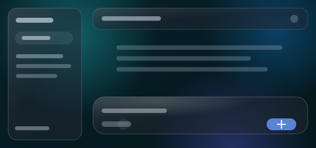
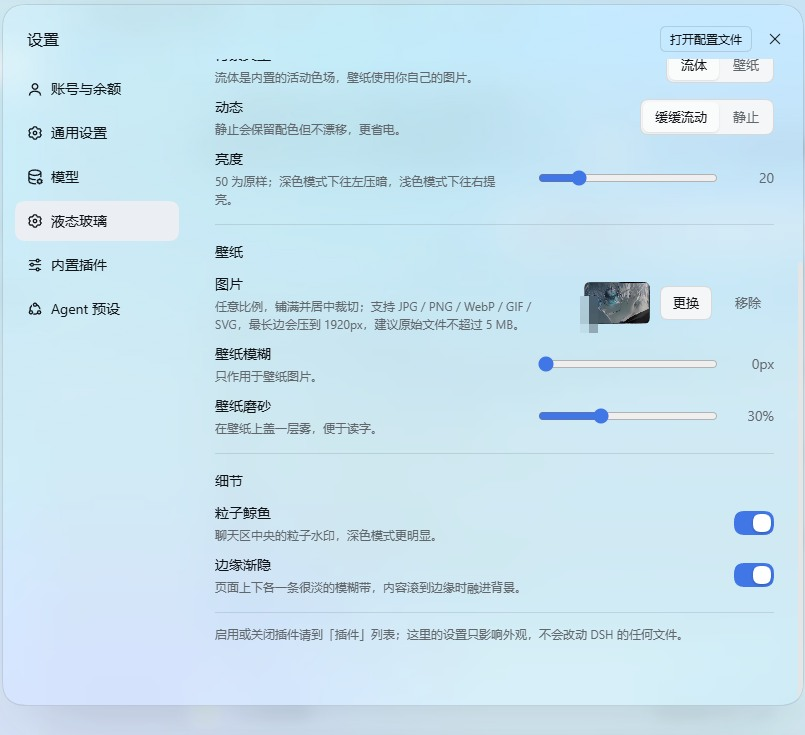

# Liquid glass for DeepSeek Harness

English | [中文](README.zh.md)

A floating-glass skin for the DeepSeek Harness web UI: a living background, and
the sidebar, conversation header and composer as panes of one frosted-glass
family — plus an optional wallpaper, a particle whale and a settings page.

Style only. The bundle injects a stylesheet and a few decorative layers into the
page; it changes no behaviour, reads no session data, makes no network requests,
and turning it off restores the stock interface exactly.

## Screenshot

The settings page and dialog in the DSH desktop build (light theme); the
wallpaper thumbnail is pixelated on purpose:

## Features

- **Living background** — three slowly drifting colour fields over a deep base,
  with a whisper of grain; or your own image wallpaper.
- **Floating cards** — sidebar, conversation header and composer share one glass
  recipe (translucent fill, hairline border, lit rim, drop shadow, backdrop
  blur); the composer adds a specular highlight that follows the pointer.
- **Glass menus** — popovers, menus and the settings dialog become frosted
  sheets; the settings mask becomes a soft veil instead of a flat scrim.
- **Settings page** — under **Settings → 液态玻璃**: master switch, blur, frost,
  background type, motion, brightness, wallpaper (pick / replace / remove, with
  its own blur and frost), particle whale, page-edge fades.
- **Details** — a particle whale watermark in the conversation column, page-edge
  fades, and a glass rim around the window frame.
- **Accessibility fallbacks** — `prefers-reduced-transparency`,
  `prefers-contrast: more` and `prefers-reduced-motion` drop the effects and fall
  back to the host's opaque surfaces.

## Install

This repository is a DSH bundle package: the files at the root are the package
itself (`package.json` declares `dsh.bundle.patch` and a `dsh.client` half).

1. Download or clone this repository.
2. In DSH open **Settings → Plugins → Add plugin**.
3. Paste the **absolute path to this folder** (the one containing `package.json`)
   into the “package name or address” field and install.
4. If DSH asks for a restart, restart it once; then enable **Liquid glass** in the
   plugin list and reload the page.

Settings and the wallpaper stay in this browser's `localStorage`; they do not
travel with the repository.

## Tuning

The settings page writes these CSS custom properties on
`html[data-liquid-glass]`; a user stylesheet can override them directly:

| Property | Meaning | Default (light / dark) |
| --- | --- | --- |
| `--lg-blur` | Card backdrop blur | `20px` |
| `--lg-frost` | Card fill multiplier | `1` |
| `--lg-brightness` | Background brightness, 50 is unchanged | `50` |
| `--lg-glass` | Card fill | `46%` white / `50%` graphite |
| `--lg-sheen` | Diagonal sheen | `26%` / `6%` white |
| `--lg-deep` | Background base colour | `#d2e6ee` / `#061c22` |
| `--lg-blob-a` / `-b` / `-c` | Background colour fields | aqua / blue / violet |
| `--lg-hairline` | Card border | `rgb(15 36 60 / 12%)` / `rgb(148 180 220 / 26%)` |
| `--lg-rim` | Lit rim | `rgb(255 255 255 / 70%)` / `rgb(255 255 255 / 8%)` |
| `--lg-specular` | Pointer highlight on the composer | `50%` / `12%` white |
| `--lg-wallpaper-blur` / `-frost` | Wallpaper blur / frost | `0px` / `12%` |

## Compatibility and limitations

- Built against **DSH 0.2.2-rc.5**. Surfaces are matched by class-name fragments
  and data attributes the shell renders today (`sidebarCol`, `[data-slot]`,
  `_card` inside `[data-composer-seat]`, `header[data-window-drag]`,
  `[data-menu-material]`, `[data-shortcut-modal="settings"]`). A future release
  that renames them degrades to the stock surfaces instead of breaking.
- The **Windows desktop caption strip** is handled for the desktop build (the
  script reserves 40 px and injects a DOM menu bar). The web build has no caption
  strip, so those rules simply do not apply.
- The desktop window itself stays opaque: true desktop transparency needs
  Electron window flags (`transparent` / `backgroundMaterial`), which a web
  bundle cannot set.
- Because the base colour is transparent, host surfaces that fade or dim *to*
  that colour no longer mask content behind them.

## License

[MIT](LICENSE)
