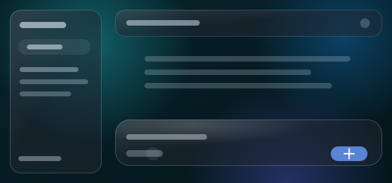
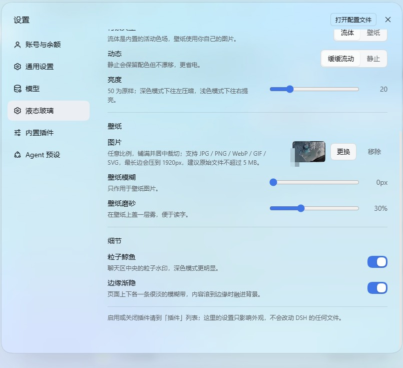

# 液态玻璃 · DeepSeek Harness 主题插件

[English](README.md) | 中文

给 DeepSeek Harness 网页端换上一整套悬浮玻璃皮肤：背后是会缓慢流动的深海色背景，
侧边栏、会话顶栏和输入卡是同一种磨砂玻璃，另带自定义壁纸、粒子鲸鱼和一个设置页。

纯前端实现：只向页面注入一份样式和几个装饰层，不改任何行为、不读取会话数据、
不发网络请求；关掉开关即完整恢复原生界面。

## 界面截图

DSH 桌面端实际运行时的设置页与玻璃面板（浅色主题；壁纸缩略图已打码）：

## 功能

- **活动背景**：三块缓慢漂移的色场 + 很淡的颗粒；也可以换成你自己的图片壁纸。
- **悬浮玻璃卡**：侧栏、会话顶栏、输入卡共用一套材质（半透明底、发丝描边、受光边、
  投影、背景模糊），输入卡还会随鼠标泛起高光。
- **玻璃弹层**：菜单、弹出层、设置面板都变成磨砂玻璃；设置面板背后的遮罩变成柔和的纱。
- **设置页**：设置 → 液态玻璃，可调总开关、模糊度、磨砂度、背景类型、动效、亮度、
  壁纸（选择/更换/移除 + 壁纸模糊/磨砂）、粒子鲸鱼、边缘渐隐。
- **细节**：聊天区中央的粒子鲸鱼水印、页面上下边缘渐隐、窗口四周的玻璃细边。
- **无障碍回退**：系统开启「降低透明度 / 提高对比度 / 减少动态效果」时自动退回不透明或静止界面。

## 安装

本仓库根目录就是插件包本身（`package.json` 里声明了 `dsh.bundle.patch` 和 `dsh.client`）。

1. 下载或克隆本仓库；
2. 打开 DSH 的 **设置 → 插件 → 添加插件**；
3. 在「包名或地址」里填入**本文件夹的绝对路径**（包含 `package.json` 的那一层）并安装；
4. 如果提示需要重启 DSH，重启一次；然后在插件列表里启用「液态玻璃」，刷新页面。

设置和壁纸保存在本机浏览器的 `localStorage` 里，不会随仓库一起走。

## 可调参数

设置页会把这些 CSS 变量写到 `html[data-liquid-glass]` 上，也可以用自己的样式覆盖：

| 变量 | 含义 | 默认值（浅色 / 深色） |
| --- | --- | --- |
| `--lg-blur` | 卡片背景模糊半径 | `20px` |
| `--lg-frost` | 卡片底色不透明度倍数 | `1` |
| `--lg-brightness` | 背景亮度，50 为原样 | `50` |
| `--lg-glass` | 卡片底色 | `46%` 白 / `50%` 石墨 |
| `--lg-sheen` | 斜向高光 | `26%` / `6%` 白 |
| `--lg-deep` | 背景底色 | `#d2e6ee` / `#061c22` |
| `--lg-blob-a` / `-b` / `-c` | 背景三块色场 | 青 / 蓝 / 紫 |
| `--lg-hairline` | 卡片描边 | `rgb(15 36 60 / 12%)` / `rgb(148 180 220 / 26%)` |
| `--lg-rim` | 受光边 | `rgb(255 255 255 / 70%)` / `rgb(255 255 255 / 8%)` |
| `--lg-specular` | 输入卡的鼠标高光 | `50%` / `12%` 白 |
| `--lg-wallpaper-blur` / `-frost` | 壁纸模糊 / 磨砂 | `0px` / `12%` |

## 兼容性与限制

- 针对 **DSH 0.2.2-rc.5** 编写。选择器依赖当前渲染的类名片段与 data 属性
  （`sidebarCol`、`[data-slot]`、`[data-composer-seat]` 里的 `_card`、
  `header[data-window-drag]`、`[data-menu-material]`、`[data-shortcut-modal="settings"]`），
  未来版本若改名，会退回原生样式而不是报错。
- **Windows 桌面端**的标题条按桌面客户端的结构处理（脚本预留 40px 并注入 DOM 菜单栏）；
  网页版没有这条标题栏，相关规则自然不生效。
- 桌面窗口本身仍是不透明的：要让窗口真正透出桌面需要 Electron 的窗口参数
  （`transparent` / `backgroundMaterial`），网页插件做不到。
- 由于基础底色被透明化，宿主里那些「淡出/变暗到底色」的粘性表面不再遮住内容。

## 许可证

[MIT](LICENSE)
